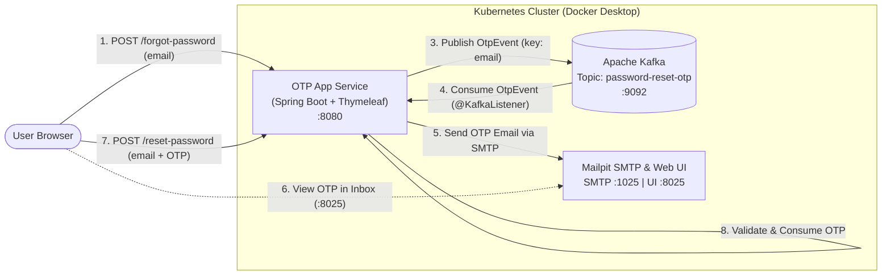

# Event-Driven OTP Password Reset Service

A cloud-native, event-driven One-Time Password (OTP) reset service built with **Spring Boot**, **Apache Kafka**, **Thymeleaf**, and **Mailpit**, containerized with **Docker** and orchestrated on **Kubernetes**.

---

## Architecture Diagram



---

## Tech Stack

* **Backend:** Java, Spring Boot, Spring Web MVC, Thymeleaf
* **Messaging:** Spring for Apache Kafka (`KafkaTemplate` & `@KafkaListener`)
* **Email Delivery & Testing:** Spring Boot Mail (`JavaMailSender`) + Mailpit (Local SMTP & Web UI)
* **Containerization & Orchestration:** Docker (Multi-stage Maven build), Kubernetes (`Deployments` & `Services`)

---

## Project Structure

```text
otp-reset-service/
├── k8s/
│   ├── 1-infra.yaml          # Kafka & Mailpit Kubernetes Deployments and Services
│   └── 2-app.yaml            # OTP Spring Boot App Deployment and Service
├── src/main/
│   ├── java/com/example/otp/ # Controllers, Kafka Producer/Consumer, OTP Store
│   └── resources/
│       ├── templates/        # Thymeleaf UI (forgot-password.html, reset-password.html)
│       └── application.yaml  # Kafka & SMTP configuration
├── Dockerfile                # Multi-stage Maven build + JRE runtime image
└── pom.xml                   # Project dependencies
```

---

## Getting Started (Local Kubernetes Deployment)

### Prerequisites
* Docker Desktop with Kubernetes enabled
* `kubectl` CLI installed

### 1. Deploy Infrastructure (Kafka & Mailpit)
```bash
kubectl apply -f k8s/1-infra.yaml
```

### 2. Build the Application Image
```bash
docker build -t otp-reset-service:1.2 .
```

*(Note: If using Docker Desktop with the containerd image store enabled, import the image directly into Kubernetes)*:
```powershell
docker save otp-reset-service:1.2 -o otp-1.2.tar
cmd /c "docker exec -i desktop-control-plane ctr -n k8s.io images import - < otp-1.2.tar"
Remove-Item otp-1.2.tar
```

### 3. Deploy the OTP Application
```bash
kubectl apply -f k8s/2-app.yaml
kubectl get pods
```

### 4. Port-Forward Services to Localhost
Open two terminal tabs and run:

**OTP Web Application:**
```bash
kubectl port-forward svc/otp-service 8081:8080
```

**Mailpit Inbox UI:**
```bash
kubectl port-forward svc/mailpit-service 8025:8025
```

---

## Usage & Verification

1. Open **`http://localhost:8081/forgot-password`** in your browser and enter an email address (e.g., `user@example.com`).
2. Open Mailpit at **`http://localhost:8025`** to view the incoming email containing the 6-digit OTP.
3. Enter the OTP and a new password on **`http://localhost:8081/reset-password`** to complete verification.
4. *(Multi-user testing)* Open an Incognito browser window with a different email address to verify isolated concurrent OTP handling.

---

## Future Roadmap
* **Distributed State:** Replace in-memory OTP storage with **Redis** (`SETEX`) for horizontal pod scaling.
* **SMS Channel:** Extend the Kafka consumer using a Strategy pattern to support SMS OTP delivery via Twilio/AWS SNS.
* **Resilience:** Add `@RetryableTopic` and Dead Letter Topics (DLT) for failed email/SMS gateway deliveries.
